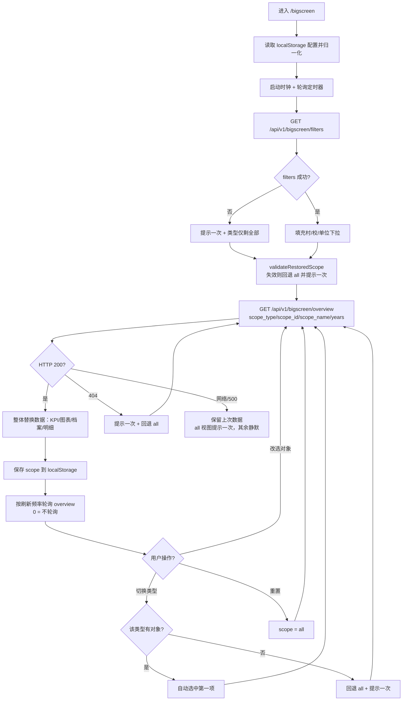

# 汇报大屏对象筛选与下钻方案

> 文档性质：设计方案（技术 + 业务混合读者）
> 适用系统：帮扶管理信息系统（MRRS）v1.12.8+
> 页面入口：`/bigscreen`（`frontend/src/router/index.ts:41-47`，无导航栏独立全屏页）
> 关联任务：task-1（后端接口）、task-2（前端大屏）、task-3（本文档 + 用户手册）
> 状态：已与最终实现逐条核对（核对结论见附录 B）

---

## 1. 背景与目标

### 1.1 汇报投屏场景的痛点

改造前的大屏只回答**全局**问题：一共帮扶了多少村、多少项目、多少学校、花了多少钱、整体完成率多少。它适合"总览式"汇报，但汇报现场经常遇到三类追问：

1. **"某某村帮扶得怎么样？"**——领导临时点名某个村，大屏无法按对象过滤，值班人员只能退出大屏、切到帮扶村/项目/经费等业务页面逐个查，现场冷场；几个页面口径不一致时更难解释。
2. **"某某学校、某某单位帮扶了哪些村、投了多少钱？"**——学校对象有独立的帮扶档案；单位只以自由文本散落在村/校/项目/结对记录上，系统没有"按单位汇总"的现成视图。
3. **"这个村享受过哪些项目、哪几笔经费、谁在结对走访？"**——大屏只有聚合数字，没有对象档案和帮扶明细，无法支撑"点开一个对象讲清楚"的汇报方式。

同时，改造前大屏一次加载要打 4 个接口（统计 / 年度趋势 / 成效排名 / 项目列表），各接口的数据域过滤实现分散，很难保证"同一屏上几个数字口径一致"。

### 1.2 目标

- 大屏顶部增加**筛选条**：类型单选（全部 / 帮扶村 / 帮扶学校 / 帮扶单位）+ 可搜索对象下拉 + 重置。
- 选中对象后，KPI、经费趋势、项目状态、年度对比、经费投入排名、负责人、**对象档案**、**帮扶明细**全部收敛到该对象，仍然"一屏讲完"。
- 数据由一个聚合接口一次返回：**首次进入 2 个请求（filters + overview），切换对象/轮询只发 1 个请求**（改造前每次 4 个）。
- 保留现有全部能力：全屏、时钟、设置抽屉（卡片显隐/排序、30/60/300 秒刷新/关闭、汇报脱敏）、localStorage 持久化。
- 数据域与全系统一致：复用 `get_org_scope`；村/校不存在或越权统一 404，前端回退"全部"且不白屏。
- 不夸大、可验收：第 9 节给出可勾选验收清单，第 4 节口径逐条对应实现。

### 1.3 不做范围（v1 明确不做）

| 不做 | 原因 / 后续 |
|------|-------------|
| 实时大屏（推送/WebSocket） | 单机离线部署，数据变更频率低，30 秒级轮询足够；见 §10.1 |
| 多对象对比（两个村并排） | 会增加筛选条与图表复杂度，v1 先保证单对象讲清楚；见 §10.2 |
| 对象轮播 / 汇报播放列表 | 属于"自动讲稿"能力，依赖多对象预取；见 §10.3 |
| 导出 PDF / 截图 | 汇报现场以投屏为主；见 §10.4 |
| 新建"单位"主数据表 / 组织表外键 | 存量数据里单位是自由文本，强行外键有迁移风险；v1 用四来源并集 facet，见 §3.7、§10.5 |
| 大屏内嵌地图、地图联动 | 地图是独立页面能力，大屏保持轻量 |
| 历史时点回放（"截至某年某月"） | 涉及快照/审计口径，v1 不做 |
| 修改或新增业务数据 | 大屏只读，不提供编辑入口 |

### 1.4 术语

| 术语 | 含义 |
|------|------|
| scope（对象维度） | 大屏当前聚焦范围：`all`（全部）/ `village`（帮扶村）/ `school`（帮扶学校）/ `unit`（帮扶单位） |
| 对象档案（profile） | 选中对象的结构化信息，后端按分组（sections）与标签（tags）返回，前端只渲染 |
| 帮扶明细（details） | 选中对象的项目 top5、经费 top5、结对/走访统计 |
| facet | 自由文本维度值（本方案中指"单位名"），由多个数据来源合并去重得到，不是外键 |
| 数据域 | 当前用户可见的数据范围，由 `get_org_scope` 统一解析（组织树可见性模型） |

---

## 2. 现状调研

> 本节描述**改造前（v1.12.8）**的实现与局限，用于说明问题来源；行号指改造前文件快照。
> 改造后的实现见 §3/§5 与附录 A 的当前行号。

### 2.1 改造前大屏页面

`frontend/src/views/bigscreen/BigScreen.vue`（改造前 553 行）结构：

| 区块 | 改造前行号 | 说明 |
|------|-----------|------|
| 页头（标题/时钟/设置/全屏） | 1-12 | 无筛选控件 |
| 设置抽屉（卡片显隐排序、刷新频率、汇报脱敏） | 15-63 | localStorage 持久化 |
| KPI 总览（5 卡） | 66-71 | `kpis` computed 在 147-171 |
| 图表区（5 张卡） | 74-97 | 经费趋势 173-198 / 排名 200-219 / 项目状态 221-247 / 年度对比 249-262 / 负责人 268-274 |
| 页脚 | 99 | `footerText` 277-284 |

关键行为：

- **一次加载打 4 个接口**：`loadAll()`（改造前 `BigScreen.vue:286-323`）依次调用 `getDashboardStats()`（291）、`getYearlyTrends(5)`（297）、`getRankings(当前年, 10)`（304）、`projectApi.list({page:1,page_size:5})`（311）。
- **失败降级**：4 个 `try/catch` 分别累计 `failedCount`，全部失败才弹一次 warning（317-322），单接口失败静默。
- **自动刷新**：`applyRefreshTimer`（373-381）按 30/60/300/0 秒重建定时器；配置持久化在 `bigscreenConfig.ts:108-128`。
- **脱敏**：仅展示层隐藏金额小数精度与负责人姓名（`bigscreenConfig.ts:131-144`），不处理 PII 字段。
- **缓存策略**：故意不传 `refresh=true`，走后端 2 分钟 diskcache（改造前 `BigScreen.vue:288-291` 注释）。

### 2.2 改造前的 4 个数据接口

| 前端调用 | 后端实现 | 关键返回字段 | 大屏用途 |
|----------|----------|--------------|----------|
| `getDashboardStats()`（`frontend/src/api/dashboard.ts:11-17`） | `GET /api/v1/dashboard/stats`，`backend/app/api/v1/data/data/dashboard.py:506-548`（router prefix 在 `:39`） | `total_villages` / `total_projects` / `total_schools` / `total_funds` / `data_completeness` / `projects_by_status` | 5 个 KPI + 项目状态饼图 |
| `getYearlyTrends(5)`（`api/dashboard.ts:61-63`） | 改造前为 `GET /api/v1/dashboard/yearly-trends` 内联聚合（现抽为 `_build_yearly_trends`，`dashboard.py:579-697`；端点 `:700-716`） | `trends[]`：`year` / `total_planned` / `total_actual` / `project_count` / `fund_count` | 经费执行趋势折线 + 年度对比柱状 |
| `getRankings(year,10)`（`frontend/src/api/effectiveness.ts:30-36`） | `GET /api/v1/effectiveness/rankings` | `rankings[]`：村名 / 得分 | 成效排名 |
| `projectApi.list(...)`（`frontend/src/api/projects.ts:29`） | `GET /api/v1/projects` | `items[].responsible_person` 等 | 重点项目负责人 |

### 2.3 现有模型里可用的对象维度字段

方案涉及的全部真实字段（改造不新增表、不改模型）：

| 模型 | 文件与行号 | 可用于对象维度的字段 |
|------|-----------|----------------------|
| `SupportedVillage` 帮扶村 | `backend/app/models/supported_village.py:39` | `id:51`、`village_name:55`、`province/city/county/township:56-59`、`support_unit:54`（帮扶单位）、`department:53`（部门单位）、`is_active:101`、`organization_id:105`、`created_by:116`、`transition_fund_military_total/local_total:88-91`、`honors:98`、区域标记 `is_three_regions` 等 `:65-85` |
| `VillagePopulation` 村级人口 | `supported_village.py:310` | `supported_village_id:323`、`year:329`、`total_households:331`、`total_population:332`、`resident_population:334`、`poverty_population:336` |
| `VillageIncome` 村级收入 | `supported_village.py:361` | `year:380`、`per_capita_income:382`（万元）、`collective_income:384` |
| 帮扶投入年度子表 | `supported_village.py:422`（产业 `IndustrySupport`）、`:397`（专项投入 `ForceInvestment`）、`:451`（基础设施 `InfrastructureImprovement`）、`:485`（党建 `PartyBuildingSupport`）、`:518`（医疗 `MedicalSupport`）、`:604`（教育 `EducationSupport`） | 均含 `supported_village_id`、`year`、`investment`（万元） |
| `School` 帮扶学校 | `backend/app/models/school.py:43` | `name:59`、`code:60`、`type:61-67`、`province/city/district:70-72`、`student_count:78`、`teacher_count:79`、`class_count:80`、`established_year:81`、`support_status:84-88`、`support_unit:89`、`support_start_date/support_end_date:90-91`、`is_active:101`、`organization_id:105`、`principal:94`（PII 姓名）、`contact_phone:95`（加密列） |
| `SchoolProject` 助学兴教项目 | `school.py:258` | `school_id:270`、`name:276`、`phase:277-281`（枚举 `:248-255`：调研/立项审批/实施/验收/已完成）、`budget:283`、`actual_cost:284`、`start_date:285` |
| `ScholarshipStudent` 资助学生 | `school.py:324` | `school_id:336`、`year:344`、`amount:345`（元）、`status:347-351` |
| `Project` 帮扶项目 | `backend/app/models/project.py:46` | `name:70`、`status:73`、`village_id:80`、`organization_id:86`、`start_date:97`、`actual_cost:94`、`responsible_unit:107`、`responsible_person:108`（PII 姓名）、`leader:105`、`is_active:143` |
| `Fund` 经费 | `backend/app/models/fund.py:59` | `amount:92`（申请金额·万元）、`planned_amount:93`、`allocated_amount:95`、`status:113`、`project_id/village_id/school_id:102-108`、`year:156`、`name:100`、`is_active:144`、`organization_id:148` |
| `PairingRecord` 结对记录 | `backend/app/models/pairing.py:23` | `subject_type:35`（unit/branch/person）、`subject_name:36`、`partner_type:45`、`village_id:46`、`school_id:52`、`status:63`（active/ended）、`is_active:79`、`organization_id:72` |
| `VisitRecord` 走访记录 | `pairing.py:115` | `pairing_id:126`、`visit_date:132`、`is_active:149` |
| `Organization` 组织 | `backend/app/models/organization.py:31` | `name:45`、`org_type:55`、`is_active:63`、`path:64`（数据域树，**不是**单位 facet 来源） |

### 2.4 改造前的局限

1. **无对象维度**：4 个接口只接受"全局 / 年份 / 条数"参数，没有任何按村、校、单位收敛的入参。
2. **口径分散**：项目状态来自 `/dashboard/stats`（`dashboard.py:281-293` 的 `projects_by_status`），年度趋势来自 `/dashboard/yearly-trends`，排名来自 `/effectiveness`，负责人来自 `/projects`；4 个接口各自做数据域过滤（`_apply_project_scope:239`、`_query_fund_stats:176`），同一屏数字来自不同查询批次。
3. **4 次请求、4 套降级**：切换口径要重发 4 个请求，前端只用一个 `failedCount` 粗略兜底。
4. **无档案、无明细**：缺"这个村/校/单位是谁、有哪些项目、花了哪些钱、谁在结对走访"。
5. **数据域语义要显式对齐**：大屏属于组织树可见性模型（地图/大屏/统计/组织树一类），沿用 `get_org_scope`（`backend/app/core/data_permission.py:386-449`）；内部列表/导出走严格口径 `filter_by_data_scope`（`:222-238`）。这是系统既有约定（R27-H8 / R28 收口），新接口必须继续用 `get_org_scope`，不能另写一套。
6. **单位没有主数据**：单位只散落在 `SupportedVillage.support_unit`、`School.support_unit`、`Project.responsible_unit`、`PairingRecord.subject_name` 四处自由文本上，无法直接按单位聚合。

---

## 3. 总体方案

### 3.1 设计原则

1. **单接口聚合**：新增 `GET /api/v1/bigscreen/overview`，一次返回 KPI + 5 类图表 + 档案 + 明细；切换对象只发一个请求。
2. **口径集中在后端**：同一 scope 下所有卡片基于同一批数据域查询派生，前端不二次拼装、不自行换算。
3. **all 口径保持现状**：`scope_type=all` 直接复用 dashboard 的统计 helper 与年度趋势聚合，与改造前数字一致（回归基线）。
4. **失败可降级**：任何异常都不白屏；最差回退"全部"视图，保留上一次成功数据。
5. **零新增依赖 / 零表结构变更**：只加路由模块与一个前端 API 文件；单位用四来源并集 facet。

### 3.2 四类 scope

| `scope_type` | 语义 | 必填参数 | 对象解析规则 | 典型汇报问题 |
|--------------|------|----------|--------------|--------------|
| `all` | 数据域内全部（默认） | 无 | 无 | "总体帮扶成效怎么样？" |
| `village` | 单个帮扶村 | `scope_id` | `supported_villages.id`，且 `is_active=True`、在数据域内 | "某某村帮扶得怎么样？" |
| `school` | 单个帮扶学校 | `scope_id` | `schools.id`，且 `is_active=True`、在数据域内 | "某某小学现在什么情况？" |
| `unit` | 单个帮扶单位（自由文本 facet） | `scope_name`（strip 后非空） | 四来源并集匹配，见 §3.7 | "某某单位帮扶了哪些村/校、投了多少钱？" |

### 3.3 页面结构（改造后）

改造后 `frontend/src/views/bigscreen/BigScreen.vue`（当前 979 行）页面结构：

```
┌────────────────────────────────────────────────────────────────────────────┐
│ 帮扶管理信息系统 · 帮扶成效总览大屏                 时钟   设置   全屏/退出全屏 │
├────────────────────────────────────────────────────────────────────────────┤
│ 查看对象 [全部][帮扶村][帮扶学校][帮扶单位]  [选择对象 ▾ 可搜索] [重置]  副标题 │
├────────────────────────────────────────────────────────────────────────────┤
│ KPI1      KPI2      KPI3      KPI4      KPI5        ← 固定 5 项，随 scope 变 │
├────────────────────────────────────────────────────────────────────────────┤
│ 经费执行趋势（line，wide 占满整行）                                          │
├──────────────────────────────────┬─────────────────────────────────────────┤
│ 经费投入排名（bar，≤8 条）        │ 项目状态分布（pie）                      │
├──────────────────────────────────┼─────────────────────────────────────────┤
│ 年度对比（bar）                   │ 重点项目负责人（list，≤5 条）            │
├──────────────────────────────────┴─────────────────────────────────────────┤
│ 对象档案（profile 卡片；仅 scope != all 时显示，半行）                       │
├────────────────────────────────────────────────────────────────────────────┤
│ 帮扶明细（details 卡片；仅 scope != all 时显示，wide 占满整行）              │
├────────────────────────────────────────────────────────────────────────────┤
│ 页脚：数据来源：本地数据库 · 每 N 秒自动刷新 · 汇报展示/脱敏模式             │
└────────────────────────────────────────────────────────────────────────────┘
```

> 卡片顺序来自 `BIG_SCREEN_CARDS`（`bigscreenConfig.ts:42-50`），其中 `fundTrend` 与 `details` 为 `wide`（占满整行）；用户可在设置抽屉里调整顺序与显隐。

- 卡片共 **7 张**（`bigscreenConfig.ts:42-50`）：经费执行趋势 / 经费投入排名 / 项目状态分布 / 年度对比 / 重点项目负责人 / 对象档案 / 帮扶明细。
- 「对象档案」「帮扶明细」仅在选择具体对象时渲染（`SCOPED_ONLY_CARD_KEYS`，`bigscreenConfig.ts:56`；渲染过滤见 `BigScreen.vue:414-418`）。
- 设置抽屉依旧可对 7 张卡片做显隐与排序，顺序与显隐均持久化。

### 3.4 筛选条交互

- **类型单选**：`el-radio-group` 四项（`BIG_SCREEN_SCOPE_OPTIONS`，`bigscreenConfig.ts:31-39`）；默认"全部"（`BigScreen.vue:14-48`）。
- **对象下拉**：`el-select filterable`，仅在 `scope != all` 时显示；选项来自 `GET /bigscreen/filters`，挂载时加载一次（`loadFilters`，`BigScreen.vue:596-607`）。
- **下拉文案**（`BigScreen.vue:472-499`）：
  - 村：`村名（县）`，无县时只显示村名；
  - 学校：`校名（区县）`，无区县时只显示校名；
  - 单位：`单位名（村N·校M·项目K）`（结对计数不展示，仅用于排序与档案）。
- **联动规则**：切换类型时若该类型有可选对象，**自动选中第一项并立即请求**（`onScopeTypeChange`，`BigScreen.vue:616-634`）；该类型无可选对象时回退"全部"并提示一次。
- **重置**：仅在选择具体对象时可用（`BigScreen.vue:46`），点击回"全部"并请求（`resetScope`，`:645-648`）。
- **副标题**：筛选条右侧显示后端回显的 `scope.subtitle`（村/校为行政区划，单位为覆盖统计，`BigScreen.vue:47`）。
- **并发控制**：切换过期的响应直接丢弃（请求序号 `overviewSeq`，`BigScreen.vue:582-593`）。
- **加载态**：overview 未返回时 KPI 使用零值骨架 `FALLBACK_KPIS`（`BigScreen.vue:267-273`），不出现整块空白。

### 3.5 对象档案（profile）

后端返回结构化 `profile`，前端按顺序渲染，不做业务判断（`BigScreen.vue:135-159`）：

```json
{
  "title": "某某村 · 对象档案",
  "sections": [
    {"title": "基础信息", "items": [{"label": "所属区域", "value": "贵州省某市某县某镇"}]},
    {"title": "人口与收入（2024年）", "items": [{"label": "总人口", "value": "1234"}]},
    {"title": "帮扶投入（2024年）", "items": [{"label": "专项投入(万元)", "value": "120.5"}]},
    {"title": "结对与走访", "items": [{"label": "结对记录数", "value": "3"}]}
  ],
  "tags": [
    {"label": "区域标记", "items": ["三区三州", "重点帮扶县"]}
  ]
}
```

约定：

- 所有 value 均为字符串；空值由后端统一输出 `"—"`（`bigscreen.py:134-145` 等格式化函数）。
- `tags` 可能为空数组（学校维度固定为空；村维度无区域标记时为空；单位维度按覆盖村/校是否为空决定）。
- 档案**不含 PII**：不含联系方式、身份证号、银行账号、家庭住址明细。
- `scope=all` 时 `profile=null`，前端不渲染该卡片。

### 3.6 帮扶明细（details）

```json
{
  "projects": [
    {"name": "某某产业路项目", "status": "in_progress", "label": "进行中",
     "amount": 120.0, "person": "张**"}
  ],
  "funds": [
    {"name": "2024 年帮扶经费（第一批）", "year": 2024,
     "status": "allocated", "label": "已拨付", "amount": 50.0}
  ],
  "pairing": {"total": 3, "active": 2, "visits": 7}
}
```

- `projects` / `funds` 各最多 5 条（`_DETAIL_LIMIT`，`bigscreen.py:60`）。
- `amount`：项目/经费金额，万元，保留 2 位小数；项目取 `actual_cost`，经费取 `amount`。
- 前端表格列（`BigScreen.vue:160-223`）：项目=项目名称/状态/金额(万元)/负责人；经费=经费名称/年度/状态/金额(万元)；结对=结对数/进行中/走访次数。
- 金额与姓名由前端统一脱敏（`displayMoney` / `formatLeaderName`）。
- 明细只读，v1 不提供跳转业务页。

### 3.7 「单位」是自由文本 facet（关键设计）

单位**不是**组织表外键，也不新建主数据。`units` 由以下四来源并集得到（每个来源各自先按数据域过滤；实现见 `bigscreen.py:_collect_unit_filters:549-595`）：

| # | 来源 | 字段 | 附加过滤 |
|---|------|------|----------|
| ① | 帮扶村 | `supported_villages.support_unit`（`models/supported_village.py:54`） | `is_active=True` |
| ② | 帮扶学校 | `schools.support_unit`（`models/school.py:89`） | `is_active=True` |
| ③ | 帮扶项目 | `projects.responsible_unit`（`models/project.py:107`） | `is_active=True` 且 `status != "cancelled"` |
| ④ | 结对记录 | `pairing_records.subject_name`（`models/pairing.py:36`） | `subject_type="unit"` 且 `is_active=True` |

合并规则（`_bump_unit_count:537-546` / `_collect_unit_filters:549-595`）：

1. **清洗**：`strip()` 去首尾空白；空串、纯空白名丢弃。
2. **合并**：同名精确合并为一条，计数累加；不做"包含/模糊"合并（避免"某某单位"误吞"某某单位二部"）。
3. **排序**：主键为三项覆盖量之和（村+校+项目）降序，次键为结对计数降序，末键为名称升序（`bigscreen.py:588-594`）。名称升序保证下拉稳定不跳。
4. **计数含义**：`village_count` / `school_count` / `project_count` / `pairing_count` 分别是该单位名在四来源中的记录条数。
5. **数据域**：`units` 只来自当前用户可见的数据，避免下拉出现"看得到名字、点进去 404"的对象。

选中单位后，`scope_type=unit&scope_name=<单位名>`；后端把该名称作为**参数绑定**匹配四来源，并进一步扩展为"覆盖对象集合"：

- **覆盖帮扶村**：`support_unit = 单位名` 的村 ∪ 该单位结对记录（`partner_type="village"`）关联的村，再用数据域收敛（`_unit_village_ids`，`bigscreen.py:1176-1205`）。
- **覆盖帮扶学校**：同理（`_unit_school_ids`，`:1208-1237`）。
- **帮扶项目**：`responsible_unit = 单位名` 的项目 ∪ 覆盖村名下的项目（`_unit_project_ids`，`:1240-1253`）。
- **经费**：关联到覆盖村 / 覆盖学校 / 覆盖项目的经费（`_unit_fund_conditions`，`:1256-1265`）。
- **结对/走访**：`subject_type="unit"` 且 `subject_name = 单位名` 的记录及其走访（`:1332-1336`）。

单位没有"不存在"的判定（自由文本），所以**单位 scope 不返回 404**，无匹配数据时返回 200 空数据。

### 3.8 改造范围（文件清单）

| 层 | 文件 | 改动 |
|----|------|------|
| 后端 | `backend/app/api/v1/data/data/bigscreen.py` | **新增**（1431 行）：`/bigscreen/filters`、`/bigscreen/overview` |
| 后端 | `backend/app/api/v1/data/data/__init__.py` | 注册 bigscreen router（`:8`、`:24`） |
| 后端 | `backend/app/api/v1/data/data/dashboard.py` | 年度趋势聚合抽为 `_build_yearly_trends`（`:579-697`），`/dashboard/yearly-trends` 行为不变（`:700-716`） |
| 后端测试 | `backend/tests/unit/api/test_bigscreen_api.py` | **新增**：四类 scope、数据域、错误分支、空数据 |
| 前端 | `frontend/src/api/bigscreen.ts` | **新增**（183 行）：类型定义 + `getBigScreenFilters()` / `getBigScreenOverview(params)` |
| 前端 | `frontend/src/views/bigscreen/BigScreen.vue` | 筛选条、对象档案、帮扶明细；数据源改为两接口 |
| 前端 | `frontend/src/views/bigscreen/bigscreenConfig.ts` | 新增 scope 持久化与归一化（`:66-125`）、第 6/7 张卡片（`:48-49`） |
| 前端测试 | `frontend/tests/unit/views/bigscreen/`、`frontend/tests/unit/api/bigscreen.test.ts` | 更新/新增 |
| 文档 | 本文、`docs/02-用户手册/数据分析功能使用指南.md`、`docs/INDEX.md` | 方案 + 操作说明 + 索引 |

不修改的：数据库模型与 Alembic、权限模块、其他业务 API。

---

## 4. 数据口径

> 金额一律**万元**、`round(..., 2)`（`_round_amount`，`bigscreen.py:129-131`）；软删模型一律过滤 `is_active=True`；数据域一律 `Depends(get_org_scope)` 的 `OrgScopeFilter`。
> 本节字段与公式均与 `backend/app/api/v1/data/data/bigscreen.py` 当前实现逐条核对。

### 4.1 通用口径

| 项 | 口径 |
|----|------|
| 数据域 | `get_org_scope`（`backend/app/core/data_permission.py:386-449`）。村/校/经费/结对用 `filter_by_org_ids(query, Model.organization_id, created_by_column=Model.created_by)`（`:286-311`）；项目沿用 `dashboard._apply_project_scope`（`dashboard.py:239-259`） |
| 数据域缓存 | `overview` 无缓存，每次按当前数据域现算 |
| 软删 | `SupportedVillage` / `School` / `Project` / `Fund` / `PairingRecord` / `VisitRecord` 均过滤 `is_active=True`；`Project` 另排除 `status == "cancelled"` |
| 对象存在性 | 村/校：`id` 命中且 `is_active=True` 且在数据域内，三者任一不满足统一 404（`AppError.not_found("帮扶村"/"帮扶学校")`，`bigscreen.py:714-726`、`:942-954`） |
| 金额 | 万元、`round(...,2)`；项目金额取 `actual_cost`，经费金额取 `Fund.amount`（申请金额，万元） |
| 完成率 | `data_completeness` 0~1 → `"88.6%"`（`_format_completeness`，`bigscreen.py:141-145`）；`None` → `"—"` |
| 人口/户数 | **每村取各自最新年份**再汇总（dashboard W18 P0-1 口径，`dashboard.py:113-146`）；村 scope 取该村最新年 `VillagePopulation`（`bigscreen.py:729-736`、`:867-869`） |
| 空数据 | 返回 200 + 空数组/0；**只有村/校对象不存在或越权才 404** |
| 字符串空值 | 统一输出 `"—"`（`_text`/`_format_*`，`bigscreen.py:134-169`；`_row_value`，`:227-236`） |

### 4.2 `scope=all`（全局，回归基线）

实现：`_collect_all_scope`（`bigscreen.py:649-709`）。`scope` 回显：`{"type":"all","id":null,"name":"全局","subtitle":"全部帮扶对象"}`。

KPI 固定 5 项：

| key | label | 公式 / 来源 |
|-----|-------|-------------|
| `villages` | 帮扶村 | `count(SupportedVillage.id)`，`is_active=True`，数据域内（`dashboard._query_village_stats`，`dashboard.py:100-111`） |
| `projects` | 帮扶项目 | `count(Project.id)`，`is_active=True`、`status != "cancelled"`，经 `_apply_project_scope`（`dashboard.py:268-279`） |
| `schools` | 帮扶学校 | `count(School.id)`，`is_active=True`，数据域内（`dashboard.py:148-163`） |
| `completeness` | 完成率 | `data_completeness`：已填 `VillagePopulation` 条数 / (村数 × 应填年份数)，应填年份数 = 当前年 − 2021 + 1，上限 1.0（`dashboard.py:321-352`） |
| `funds` | 经费总额 | `sum(Fund.amount)`，`is_active=True`；非全量访问者按"村在域内 或 未关联村且经费组织在域内"过滤（`dashboard.py:176-236`） |

图表：

| 字段 | 口径 |
|------|------|
| `fund_trend` | 复用 `_build_yearly_trends`：`Fund.year` 分组，`planned=sum(planned_amount)`、`actual=sum(allocated_amount)`，缺年补 0（`dashboard.py:636-697`） |
| `yearly` | 同上聚合：`project_count` 按 `Project.start_date` 年份、`fund_count` 为经费记录条数（`dashboard.py:667-689`） |
| `project_status` | `projects_by_status`（`dashboard.py:281-293`）→ 固定输出四项 `completed/approved/in_progress/pending`（中文标签 已完成/已审批/进行中/待审批），未识别的状态按 key 升序追加、标签回退原始 key（`_project_status_items`，`bigscreen.py:246-256`） |
| `rankings` | `_village_fund_rankings`：按村 `SUM(Fund.allocated_amount)` 降序前 8，金额万元 2 位小数（`bigscreen.py:620-646`） |
| `leaders` | `_project_leaders`：按项目 `actual_cost` 降序前 5；`person = responsible_person or leader or ""`，`unit = responsible_unit`（`bigscreen.py:418-433`） |
| `profile` / `details` | 均为 `null` |

### 4.3 `scope=village`（单个帮扶村）

实现：`_collect_village_scope`（`bigscreen.py:863-938`）。`scope` 回显：`{"type":"village","id":<id>,"name":"<村名>","subtitle":"<省+市+县+乡镇>"}`。

KPI 固定 5 项：

| key | label | 公式 / 来源 |
|-----|-------|-------------|
| `population` | 总人口 | 该村最新年份 `VillagePopulation.total_population`（`_latest_village_population`，`:729-736`；`:882-888`） |
| `households` | 总户数 | 同表最新年份 `total_households`（`:889-894`） |
| `projects` | 帮扶项目 | `count(Project.id)`，`village_id = scope_id`、`is_active=True`、排除 `cancelled`，经数据域（`:377-380`、`:895-900`） |
| `funds` | 经费总额 | `sum(Fund.amount)`，`village_id = scope_id`、`is_active=True`，按经费组织数据域（`:317-324`、`:901-906`） |
| `visits` | 走访次数 | 该村结对记录（`partner_type="village"` 且 `village_id=scope_id`）下的 `VisitRecord` 计数（`:870-874`、`:469-483`；KPI 在 `:907`） |

图表：

- `fund_trend` / `yearly`：按 `years` 年窗口（默认 5）聚合：`Fund.year` 计划/实际投入与经费条数、`Project.start_date` 年份项目数（`:877-881`、`_fund_trend_lists:282-306`）。
- `project_status`：该村项目 `Project.status` 分组，固定四项 + 未知状态追加（`:929-931`）。
- `rankings`：该村项目按 `actual_cost` 降序前 8（`_project_rankings`，`:405-415`；`:933`）。
- `leaders`：该村项目按 `actual_cost` 降序前 5（`:934`）。

对象档案 `profile`（`_build_village_profile`，`:842-860`；title=`{村名} · 对象档案`）：

| Section | 内容（label 原文） |
|---------|-------------------|
| 基础信息 | 所属区域、帮扶单位、部门单位、振兴梯队（是/否）、过渡状态（中文标签）（`:781-799`） |
| 人口与收入（{最新年}年） | 仅当人口或收入数据存在时输出：总户数、总人口、常住人口、脱贫人口、村人均纯收入(万元)、村集体收入(万元)（无值为 `"—"`）（`:802-815`） |
| 帮扶投入（{最新年}年）或「帮扶投入」 | 专项投入(万元)、协调地方投入(万元)；若存在年度帮扶投入子表，追加该年度：产业投入(万元)、基础设施投入(万元)、党建投入(万元)、医疗投入(万元)、教育投入(万元)（`:818-831`、`_latest_support_investments:758-778`） |
| 结对与走访 | 结对记录数、进行中、走访次数（`:486-496`） |

`tags`：区域标记（`_VILLAGE_TAG_FIELDS`，`bigscreen.py:105-114`）：三区三州、边疆地区、民族地区、革命地区、重点帮扶县、省级示范、百村示范、梯次振兴；无任何标记时 `tags=[]`（`:834-839`）。

`details`（`:909-917`）：

- `projects`：该村项目按 `actual_cost` 降序前 5；`amount=actual_cost`，`label` 为中文状态，`person = responsible_person or leader`（`_project_detail_rows`，`:436-455`）。
- `funds`：该村经费按 `Fund.year` 倒序、`id` 倒序前 5；`amount=Fund.amount`，`label` 为中文经费状态（`_fund_detail_rows`，`:343-362`）。
- `pairing`：`{total, active, visits}`（村结对记录总数 / active 数 / 走访数）。

### 4.4 `scope=school`（单个帮扶学校）

实现：`_collect_school_scope`（`bigscreen.py:1088-1171`）。`scope` 回显：`{"type":"school","id":<id>,"name":"<校名>","subtitle":"<省+市+区县>"}`。

KPI 固定 5 项：

| key | label | 公式 / 来源 |
|-----|-------|-------------|
| `students` | 学生人数 | `School.student_count`（`:1108-1114`） |
| `teachers` | 教师人数 | `School.teacher_count`（`:1115-1120`） |
| `classes` | 班级数量 | `School.class_count`（`:1121-1126`） |
| `projects` | 学校项目数 | `len(SchoolProject where school_id=scope_id)`（`_load_school_projects`，`:968-987`；KPI 在 `:1127`） |
| `funds` | 经费总额 | `sum(Fund.amount)`，`Fund.school_id = scope_id`、`is_active=True`，按经费组织数据域（`:1128-1133`） |

图表：

- `project_status`：改用 `SchoolProject.phase`，固定五键 `research/approval/implementation/acceptance/completed`（中文：调研/立项审批/实施/验收/已完成），未识别/未设置阶段追加（`_school_phase_items`，`:259-269`、`_school_phase_counts` `:1013-1019`；`:1144`）。**阶段列用 `cast(SchoolProject.phase, String)` 读取**，库内 SQLEnum 以**大写枚举名**落库时由 `_phase_key`（`:198-201`、别名表 `:78-85`）归一为小写五键，避免历史脏值/未知枚举导致整屏 500。
- `fund_trend` / `yearly`：经费按 `Fund.year`、学校项目按 `SchoolProject.start_date` 年份（`:1095-1099`、`:957-965`）。
- `rankings`：学校项目按 `actual_cost` 降序前 8（复用 `_school_project_rows`，`:1022-1033`；`:1107`、`:1146-1148`）。
- `leaders`：学校项目按 `actual_cost` 降序前 5；因 `SchoolProject` 无负责人字段，`person` 取项目 `category`（项目类别）、`unit=null`（`:1149-1152`）。**这是学校维度的已知口径限制**，见附录 B。

对象档案 `profile`（`_build_school_profile`，`:1036-1085`；title=`{校名} · 对象档案`；`tags=[]`）：

| Section | 内容（label 原文） |
|---------|-------------------|
| 基础信息 | 所属区域、帮扶单位、帮扶状态（帮扶中/未帮扶/已完成/未设置）、帮扶起止日期（`YYYY-MM-DD 至 YYYY-MM-DD`，缺失 `—`） |
| 办学规模 | 学生人数、教师人数、班级数量、建校年份 |
| 助学帮扶 | 学校项目数、预算合计(万元)、实际投入合计(万元)、资助学生数、资助金额合计(元)（`_scholarship_stats`，`:990-1000`；`_school_project_totals`，`:1003-1010`；金额单位**元**，非万元） |
| 结对与走访 | 结对记录数、进行中、走访次数（该校 `partner_type="school"` 的结对） |

`details`（`:1162-1170`）：

- `projects`：学校项目按 `actual_cost` 降序前 5；`status=phase`、`label` 中文阶段、`amount=actual_cost`、`person=category`。
- `funds`：`Fund.school_id = scope_id` 的经费前 5（年度/ID 倒序）。
- `pairing`：该校结对统计。

> 数据域说明：`SchoolProject` / `ScholarshipStudent` 无组织列，查询以"学校已通过数据域校验"（`:1092`）为前提按 `school_id` 收敛（`:1093`、`:1105`）。

### 4.5 `scope=unit`（单个帮扶单位）

实现：`_collect_unit_scope`（`bigscreen.py:1326-1389`）。`scope` 回显：`{"type":"unit","id":null,"name":"<单位名>","subtitle":"覆盖 N 个帮扶村 / M 所帮扶学校"}`。

覆盖对象集合（先按数据域过滤，再逐步扩展）：

| 集合 | 规则 |
|------|------|
| 覆盖帮扶村 | `support_unit = 单位名` 的村 ∪ 该单位结对记录（`partner_type="village"`、`village_id` 非空）关联的村，二次按有效村与数据域收敛（`_unit_village_ids`，`:1176-1205`） |
| 覆盖帮扶学校 | 同理（`_unit_school_ids`，`:1208-1237`） |
| 帮扶项目 | `responsible_unit = 单位名` 的项目 ∪ 覆盖村名下的项目；`is_active=True`、排除 `cancelled`、数据域内（`_unit_project_ids`，`:1240-1253`） |
| 经费 | 关联到覆盖村 / 覆盖学校 / 覆盖项目的 `Fund`（三路 OR），再按经费组织数据域收敛（`_unit_fund_conditions`，`:1256-1265`；`:1338-1345`） |
| 结对/走访 | `subject_type="unit"` 且 `subject_name = 单位名` 的结对记录及其走访（`:1332-1336`） |

KPI 固定 5 项（`:1355-1361`）：

| key | label | 公式 / 来源 |
|-----|-------|-------------|
| `villages` | 覆盖帮扶村 | `len(覆盖帮扶村 ids)`（`:1356`） |
| `schools` | 覆盖帮扶学校 | `len(覆盖帮扶学校 ids)`（`:1357`） |
| `projects` | 帮扶项目 | `len(覆盖项目 ids)`（`:1358`） |
| `funds` | 经费投入 | 上述经费条件 `sum(Fund.amount)`（`:1339`、`:1359`） |
| `visits` | 结对走访次数 | 该单位结对记录下的 `VisitRecord` 计数（`:1360`） |

图表：

- `rankings`：覆盖村集合非空时按村 `SUM(Fund.allocated_amount)` 降序前 8（`_village_fund_rankings`，`:1351-1352`）；覆盖村为空时回退项目 `actual_cost` 降序前 8（`_project_rankings`，`:1353-1354`）。
- `fund_trend` / `yearly` / `project_status` / `leaders`：基于覆盖项目集合与经费条件聚合（`:1346-1376`）。
- 单位无匹配数据时：KPI 全 0、图表空、`profile` 仍返回"单位概况"（计数为 0）与空 tags。

对象档案 `profile`（`_build_unit_profile`，`:1292-1323`；title=`{单位名} · 帮扶档案`）：

| Section | 内容（label 原文） |
|---------|-------------------|
| 单位概况 | 覆盖帮扶村、覆盖帮扶学校、帮扶项目、经费投入(万元)、结对记录、走访次数 |

`tags`：`覆盖帮扶村`（最多 30 个村名，按名称升序）、`覆盖帮扶学校`（最多 30 个校名）；`_COVERAGE_NAME_LIMIT=30`（`bigscreen.py:61`）。同名集合为空时该组不输出（`:1316-1322`）。

`details`：项目 top5（按 `actual_cost` 倒序）、经费 top5（按年度/ID 倒序）、结对统计（`:1380-1388`）。

### 4.6 图表字段与排序

| 字段 | 结构 | 取值范围 / 排序 |
|------|------|------------------|
| `fund_trend` | `[{year, planned, actual}]` | 最近 `years` 个自然年（默认 5，范围 1..10），缺年补 0，金额 2 位小数（`_year_window:276-279`、`_fund_trend_lists:282-306`） |
| `project_status` | `[{key, label, value}]` | all/village/unit 用 `Project.status`；school 用 `SchoolProject.phase`；固定键 + 未知键追加，`value` 整数 |
| `yearly` | `[{year, project_count, fund_count}]` | 同 `fund_trend` 年份窗口 |
| `rankings` | `[{name, score}]` | 最多 8 条（`_RANKING_LIMIT`，`:58`），score 万元 2 位小数 |
| `leaders` | `[{name, person, unit}]` | 最多 5 条（`_LEADER_LIMIT`，`:59`）；`person` 空串兜底，`unit` 可空 |

### 4.7 单位 facet 的匹配细则

1. **名称清洗**：仅 `strip()`；中文单位名不做大小写/全半角转换（避免把"某某支队"和"某某支队 "当成两个单位）。
2. **精确匹配**：选中单位后按 `col == scope_name` 匹配（SQLAlchemy 参数绑定）；**不做模糊匹配**，也不拼接 `LIKE`，避免误命中与注入面。
3. **名称长度**：`scope_name` 接口上限 200（与 `Project.responsible_unit` / `support_unit` 列宽一致，`bigscreen.py:1416`），超过由 FastAPI 返回 422。
4. **计数**：`units` 每个元素返回四类计数，供用户判断"这个单位管几个村/校/项目/结对"。
5. **空名**：`scope_name.strip() == ""` 直接 400（后端兜底，前端不会提交空值）。

### 4.8 边界与空值

| 场景 | 行为 |
|------|------|
| 村/校 `scope_id` 不存在 | 404（`AppError.not_found` → 响应体 `{"code":404,"message":"帮扶村不存在"/"帮扶学校不存在","success":false}`） |
| 村/校已软删（`is_active=False`） | 404（与"不存在"一致，不泄漏） |
| 村/校在库但不在数据域 | 404（与"不存在"一致，不泄漏） |
| `scope_type` 非法 | 400，`message="不支持的筛选维度: <值>"`（`:1400-1401`） |
| `village`/`school` 缺 `scope_id` | 400，`message="缺少对象 ID"`（`:1407-1408`） |
| `unit` 缺 `scope_name` 或 strip 后为空 | 400，`message="单位名称不能为空"`（`:1402-1406`） |
| `years` 越界（<1 或 >10） | FastAPI Query 校验返回 422（`:1417`） |
| `scope_name` 超过 200 字符 | FastAPI Query 校验返回 422（`:1416`） |
| 对象存在但无任何业务数据 | 200：KPI 为 0/`"—"`，图表空数组，前端空态 |
| 单位名无匹配 | 200：KPI 全 0，仅返回单位概况档案 |

---

## 5. API 契约

### 5.1 通用约定

- 前缀：`/api/v1`（`backend/app/api/v1/__init__.py:29`），新模块 prefix `/bigscreen`（`bigscreen.py:54`），最终路径 `/api/v1/bigscreen/...`。
- 鉴权：登录态（全局依赖）+ 数据域（`data_scope: OrgScopeFilter = Depends(get_org_scope)`）；未登录由全局依赖返回 401。
- 成功响应：`success_response(data=..., message=...)`（`backend/app/core/response.py`），结构：

```json
{"code": 200, "success": true, "message": "成功", "data": {}}
```

- 错误响应：`AppError` 全局处理器输出 `{"code": <status>, "message": "<中文原因>", "success": false}`（`backend/app/core/exceptions.py:164-170`），**不含 detail/堆栈**；FastAPI 参数校验错误为 422。
- 字段命名：响应使用 **snake_case**（与 `dashboard.py` 现有接口一致，前端直接按 snake_case 取值）。
- 前端封装：`frontend/src/api/bigscreen.ts` 使用 `@/api/request` 的 `get()`，自动拆信封；`BigScreen.vue` 负责捕获异常与降级。

### 5.2 `GET /api/v1/bigscreen/filters`

**用途**：一次性返回筛选条所需的对象清单，挂载时调用一次。实现：`bigscreen.py:598-613`。

**请求参数**：无。

**响应示例**（`message="筛选项已获取"`）：

```json
{
  "code": 200,
  "success": true,
  "message": "筛选项已获取",
  "data": {
    "villages": [
      {"id": 12, "name": "某某村", "county": "某某县", "support_unit": "某某单位"}
    ],
    "schools": [
      {"id": 7, "name": "某某小学", "district": "某某区", "support_unit": "某某单位"}
    ],
    "units": [
      {"name": "某某单位", "village_count": 2, "school_count": 1,
       "project_count": 3, "pairing_count": 4}
    ]
  }
}
```

**字段说明**：

| 字段 | 类型 | 说明 |
|------|------|------|
| `villages[]` | array | `id` / `name` / `county`（可空）/ `support_unit`（可空）；仅 `is_active=True`、数据域内；按 `village_name` 升序、`id` 升序（`:503-517`） |
| `schools[]` | array | `id` / `name` / `district`（可空）/ `support_unit`（可空）；仅 `is_active=True`、数据域内；按 `name` 升序、`id` 升序（`:520-534`） |
| `units[]` | array | `name` / `village_count` / `school_count` / `project_count` / `pairing_count`；四来源并集去重与排序规则见 §3.7（`:549-595`）；无数据返回 `[]` |

**错误**：未登录 401；数据库/未捕获异常 → 500（`message="筛选项查询失败，请稍后重试"`，`bigscreen.py:610-612`）。

### 5.3 `GET /api/v1/bigscreen/overview`

**用途**：按当前 scope 一次返回大屏全部数据。实现：`bigscreen.py:1412-1431`。

**请求参数**（Query）：

| 参数 | 类型 | 必填 | 默认 | 说明 |
|------|------|------|------|------|
| `scope_type` | string | 否 | `all` | `all` / `village` / `school` / `unit`；非法值 400 |
| `scope_id` | int | 条件必填 | — | `village`/`school` 必填；缺参 400；不存在/越权 404 |
| `scope_name` | string | 条件必填 | — | `unit` 必填；`strip()` 后为空 400；上限 200 字符（超长 422） |
| `years` | int | 否 | `5` | 年度窗口 `1..10`；越界 422 |

**响应示例（scope=village）**（`message="大屏概览已获取"`）：

```json
{
  "code": 200,
  "success": true,
  "message": "大屏概览已获取",
  "data": {
    "scope": {"type": "village", "id": 12, "name": "某某村",
              "subtitle": "贵州省某市某县某镇"},
    "kpis": [
      {"key": "population", "label": "总人口", "value": 1234, "unit": "人"},
      {"key": "households", "label": "总户数", "value": 456, "unit": "户"},
      {"key": "projects", "label": "帮扶项目", "value": 5, "unit": "个"},
      {"key": "funds", "label": "经费总额", "value": 120.5, "unit": "万元"},
      {"key": "visits", "label": "走访次数", "value": 7, "unit": "次"}
    ],
    "fund_trend": [
      {"year": 2022, "planned": 30.0, "actual": 28.5}
    ],
    "project_status": [
      {"key": "completed", "label": "已完成", "value": 1},
      {"key": "approved", "label": "已审批", "value": 0},
      {"key": "in_progress", "label": "进行中", "value": 3},
      {"key": "pending", "label": "待审批", "value": 0}
    ],
    "yearly": [
      {"year": 2022, "project_count": 2, "fund_count": 3}
    ],
    "rankings": [
      {"name": "某某产业路项目", "score": 88.0}
    ],
    "leaders": [
      {"name": "某某产业路项目", "person": "张**", "unit": "某某单位"}
    ],
    "profile": {
      "title": "某某村 · 对象档案",
      "sections": [
        {"title": "基础信息", "items": [{"label": "所属区域", "value": "贵州省某市某县某镇"}]}
      ],
      "tags": [
        {"label": "区域标记", "items": ["三区三州"]}
      ]
    },
    "details": {
      "projects": [
        {"name": "某某产业路项目", "status": "in_progress",
         "label": "进行中", "amount": 120.0, "person": "张**"}
      ],
      "funds": [
        {"name": "2024 年帮扶经费（第一批）", "year": 2024,
         "status": "allocated", "label": "已拨付", "amount": 50.0}
      ],
      "pairing": {"total": 3, "active": 2, "visits": 7}
    }
  }
}
```

**顶层字段说明**：

| 字段 | 类型 | 说明 |
|------|------|------|
| `scope` | object | `type`（回显）、`id`（all/unit 为 null）、`name`（all=`全局`）、`subtitle`（村/校=行政区划、单位=`覆盖 N 个帮扶村 / M 所帮扶学校`、all=`全部帮扶对象`） |
| `kpis` | array | **固定 5 项**，`{key,label,value,unit}`；`value` 为 number 或 string（完成率是 `"88.6%"`，无数据 `"—"`）；前端按 `key` 渲染，不依赖下标 |
| `fund_trend` | array | 见 §4.6 |
| `project_status` | array | 见 §4.6；village/all/unit 用 `Project.status`，school 用 `SchoolProject.phase` |
| `yearly` | array | 见 §4.6 |
| `rankings` | array | 最多 8 条 |
| `leaders` | array | 最多 5 条 |
| `profile` | object\|null | `scope=all` 为 `null` |
| `details` | object\|null | `scope=all` 为 `null` |

**四类 scope 的 KPI 契约**（key/label/unit 均为后端固定值，前端不硬编码）：

| scope | 5 项 KPI（key: label / unit） |
|-------|------------------------------|
| `all` | `villages`: 帮扶村 / 个；`projects`: 帮扶项目 / 个；`schools`: 帮扶学校 / 所；`completeness`: 完成率 / （空）；`funds`: 经费总额 / 万元 |
| `village` | `population`: 总人口 / 人；`households`: 总户数 / 户；`projects`: 帮扶项目 / 个；`funds`: 经费总额 / 万元；`visits`: 走访次数 / 次 |
| `school` | `students`: 学生人数 / 人；`teachers`: 教师人数 / 人；`classes`: 班级数量 / 个；`projects`: 学校项目数 / 个；`funds`: 经费总额 / 万元 |
| `unit` | `villages`: 覆盖帮扶村 / 个；`schools`: 覆盖帮扶学校 / 所；`projects`: 帮扶项目 / 个；`funds`: 经费投入 / 万元；`visits`: 结对走访次数 / 次 |

### 5.4 错误码

| HTTP | 场景 | 响应体（示例） | 前端处理 |
|------|------|----------------|----------|
| 400 | `scope_type` 非法 | `{"code":400,"message":"不支持的筛选维度: xxx","success":false}` | 理论上不出现（前端受控单选）；回退 all |
| 400 | village/school 缺 `scope_id` | `{"code":400,"message":"缺少对象 ID","success":false}` | 回退 all |
| 400 | unit 缺 `scope_name`/空白 | `{"code":400,"message":"单位名称不能为空","success":false}` | 回退 all |
| 404 | 村不存在/已软删/越权 | `{"code":404,"message":"帮扶村不存在","success":false}` | `ElMessage.warning`（每次实例一次）+ 回退 all + 重载 |
| 404 | 学校不存在/已软删/越权 | `{"code":404,"message":"帮扶学校不存在","success":false}` | 同上 |
| 422 | `years` 越界 / `scope_name` 超长 / 类型错误 | FastAPI 校验错误结构 | 前端固定传合法值，正常不触发；回退 all |
| 401 | 未登录/登录过期 | 全局拦截器处理 | 跳登录页（现有机制） |
| 500 | 数据库/未捕获异常 | `{"code":500,"message":"服务器内部错误","success":false}` 或筛选项专用文案 | 静默降级：保留上次数据 + `logger.warn` |

### 5.5 数据域说明

- 两个接口都依赖 `data_scope: OrgScopeFilter = Depends(get_org_scope)`（`bigscreen.py:600`、`:1418`），与 `dashboard.py:510` 等现有端点一致。
- `filters` 的三个清单均按数据域过滤：受限用户的下拉里不会出现越权对象。
- `overview` 的每个查询都叠加数据域：村/校/经费/结对按组织列（+`created_by`）收敛，项目按 `_apply_project_scope` 语义收敛，学校子表（`SchoolProject`/`ScholarshipStudent`）以"学校已通过数据域校验"为前提按 `school_id` 收敛。
- `scope=all` 在管理员下等同全局，受限用户等同"我的数据域内全部"，均不越权。

---

## 6. 交互流程

### 6.1 首次加载

1. 进入 `/bigscreen`（`frontend/src/router/index.ts:41-47`）→ 组件挂载。
2. 读取 localStorage 配置并归一化（`bigscreenConfig.ts:134-175`），恢复卡片显隐/顺序、刷新频率、脱敏开关、上次 scope。
3. 启动时钟与轮询定时器（`BigScreen.vue:717-723`），再执行 `initData()`（`:610-613`）：
   - 先 `loadFilters()` 拉取对象清单（一次），随后 `validateRestoredScope()` 校验上次 scope 是否仍有效；失效则回退"全部"并提示一次（`:553-565`）。
   - 再 `loadOverview()` 按当前 scope 拉取数据。
4. 渲染 KPI → 图表 → 档案/明细（scope != all）。

### 6.2 选择对象

1. 切换类型（全部/村/校/单位）：`onScopeTypeChange`（`BigScreen.vue:616-634`）
   - 切回"全部"：清空对象、立即请求 `scope_type=all`。
   - 切换到村/校/单位：若该类型有可选对象，**自动选中第一项并立即请求**；无可选对象时回退"全部"并提示一次。
2. 在下拉中改选对象：`onScopeObjectChange`（`:636-643`）→ 更新 scope → 请求 `overview`。
3. 请求成功：整体替换 `overview` 数据（不做增量合并），KPI/图表/档案/明细同步刷新。
4. 请求失败：见 §6.6；过期响应（用户已切到别的 scope）直接丢弃（`:582-593`）。

### 6.3 重置

点击"重置"（仅在选择具体对象时可用）→ scope 回 `all` → 请求 `overview?scope_type=all` → 档案/明细卡片隐藏 → 更新 localStorage。

### 6.4 自动刷新

- 刷新频率来自设置抽屉：30 秒 / 60 秒 / 5 分钟 / 关闭（`bigscreenConfig.ts:15-20`）。
- 每次触发只重发**当前 scope** 的 `overview`（`applyRefreshTimer`，`BigScreen.vue:700-708`），不重发 `filters`。
- 关闭自动刷新时不产生任何轮询请求。
- 轮询失败按 §6.6 静默处理，不弹窗（all 视图连续失败会提示一次）、不清空数据。

### 6.5 配置持久化与恢复

- localStorage key：`bigscreen:config`（`bigscreenConfig.ts:12`）。
- 持久化内容：卡片显隐/顺序、刷新频率、脱敏开关、当前 scope（`{type, id, name}`）。
- 读取归一化（`normalizeBigScreenConfig` / `normalizeBigScreenScope`，`bigscreenConfig.ts:109-164`）：非法 JSON、未知卡片 key、重复卡片、非法刷新频率、非法 scope（村/校缺整数 id、单位缺名称）一律回默认（all）。
- `filters` 加载完成后校验：保存的村/校 id 或单位名不在清单中 → 回退 all，提示一次（`BigScreen.vue:553-565`）。
- 存储不可用（隐私模式/配额满）时静默降级为"仅本次会话生效"（`bigscreenConfig.ts:177-187`）。
- 仅存 scope 标识，不存 token、金额、人员信息。

### 6.6 失败降级（与实现一致）

| 失败点 | 行为 |
|--------|------|
| `filters` 失败 | 下拉清空、类型选项只剩"全部"（`scopeTypeOptions`，`BigScreen.vue:467-469`）；提示一次"筛选对象加载失败，仅保留「全部」视图"（`:596-607`）；`overview(all)` 照常 |
| `overview` 404（对象已删/越权） | 提示一次"所选对象不存在或无权查看，已恢复「全部」视图"（`warnOnce` 去重）→ 回退 all → 自动重新请求（`:568-579`） |
| `overview` 非 404 失败（网络/500）且 scope != all | 静默：保留上次成功数据 + `logger.warn`（`:575-578`） |
| `overview` 非 404 失败且 scope = all | 保留上次数据 + 提示一次"大屏数据加载失败，请检查服务连接"（`:576-578`） |
| 恢复的 scope 失效 | 提示一次"所选对象不存在，已恢复「全部」视图"（`:553-565`） |
| 全部接口失败 | 保持零值/空态，不白屏 |
| 组件卸载 | 清理时钟/轮询定时器与全屏事件监听（`:725-729`） |

告警去重键：`warned = {filters, overview, scope}`，同一大屏实例内每类只提示一次（`BigScreen.vue:297-304`）。

### 6.7 流程图



---

## 7. 权限与安全

| 关注点 | 措施 | 依据 |
|--------|------|------|
| 数据域单一入口 | 只通过 `Depends(get_org_scope)` 取数据域，不自行解析角色/组织 | `backend/app/core/data_permission.py:386-449`；CONTEXT.md 不变量 1 |
| 组织树可见性语义 | 大屏属 org-tree 可见性模型（地图/大屏/统计/组织树），沿用 `get_org_scope`（admin 全量），与内部列表/导出的严格口径分离 | ADR-0002、R27-H8/R28 收口；`data_permission.py` 模块头注释 |
| 越权 404 不泄漏存在性 | 村/校"不存在 / 已软删 / 无权访问"统一 404 同一文案；响应不含对象归属、组织、是否存在 | `bigscreen.py:714-726`、`:942-954`；`exceptions.py:164-170` |
| 单位名参数 | `scope_name` 仅作为 SQLAlchemy 参数绑定 `col == scope_name`；**禁止字符串拼接 SQL / f-string SQL**；不做 `LIKE` 模糊匹配 | `bigscreen.py:537-595`、`:1176-1265`；`scripts/check_raw_sql_fstrings.py` 门禁 |
| 入参校验 | `scope_type` 白名单、`scope_id` 整数、`scope_name` strip 非空 + 上限 200、`years` 1..10 | `bigscreen.py:1396-1417` |
| 无 PII 输出 | `profile`/`details` 不含身份证号、联系电话、银行账号、家庭住址；姓名（负责人/校长）仅出现在必要的展示字段，由前端"汇报脱敏"开关打码；档案未输出 `school.principal` / `contact_phone` 等字段 | `bigscreen.py:781-1085`、`:1292-1323`；`models/project.py:178-253` 的 PII 默认脱敏约定 |
| 脱敏 | 金额小数精度隐藏 + 姓名 `maskName`（`frontend/src/utils/desensitize.ts:54-59`）；脱敏是**展示层**措施，不替代接口权限 | `bigscreenConfig.ts:189-203`、`BigScreen.vue:307-326` |
| 前端存储 | localStorage 仅存卡片配置/刷新频率/脱敏开关/scope 标识；不存 token、金额、人名 | `bigscreenConfig.ts:12-187` |
| 响应信封 | 成功用 `success_response`；错误用 `AppError`/全局处理器，不带堆栈 | `docs/03-开发文档/前后端契约规范.md:8-37`；`exceptions.py:164-219` |
| 审计 | 两个接口均为只读，不写工作日志；不新增写操作 | CONTEXT.md 不变量 5（写操作才留痕） |

---

## 8. 性能与降级

### 8.1 请求数与查询次数

| 场景 | 改造前 | 改造后 |
|------|--------|--------|
| 首次进入大屏 | 4 个 HTTP 请求 | 2 个（filters + overview） |
| 切换对象 | 4 个 HTTP 请求 | 1 个（overview） |
| 30 秒轮询一次 | 4 个 HTTP 请求 | 1 个（overview） |

`filters` 只在挂载时请求一次；`overview` 内部按 scope 做有限条聚合查询，均命中现有索引（§8.3）。单位维度需要"覆盖对象集合"，查询条数比村/校略多，但集合规模为百级，仍在毫秒级。

### 8.2 无缓存理由

v1 **不给 `overview` 加缓存**：

1. **本地单机 SQLite**：数据库文件在本地磁盘，聚合查询毫秒级，网络/序列化开销大于查询本身。
2. **数据量小**：帮扶村/学校百级，项目/经费/结对千级；缓存收益有限。
3. **缓存键复杂**：结果随 `(用户数据域, scope_type, scope_id, scope_name, years)` 变化，键设计错误会出现跨用户越权（`dashboard.py:930-943` 的 recent-activities 缓存已踩过同类坑：共享缓存只对全量访问者启用）。
4. **汇报时效**：30 秒轮询下 2 分钟缓存会让刚录入的数据滞后；切换对象也无法按 scope 分键。
5. **all 口径已复用 dashboard helper**：`overview(all)` 直接调用 dashboard 的统计/趋势函数，不读 dashboard 的 diskcache，避免"切对象后看到旧全局数"。

后续若数据量增长，可按 `(user_id, scope_type, scope_id, scope_name, years)` 做 60 秒短缓存，键必须含用户维度（§10.6）。

### 8.3 索引依据

对象筛选的查询条件均有现成索引（改造不新增索引）：

| 查询 | 索引 |
|------|------|
| 村按组织/创建者 | `ix_supported_villages_organization_id`、`ix_supported_villages_created_by`（`models/supported_village.py:44-49`） |
| 村人口按村/年度 | `uq_village_population_year`、`ix_village_population_village_id`（`supported_village.py:315-320`） |
| 学校按帮扶单位 | `ix_schools_support_unit`、`ix_schools_is_active`（`models/school.py:48-56`） |
| 项目按村/状态/组织/日期 | `ix_projects_village_id`、`ix_projects_village_status`、`ix_projects_status_village`、`ix_projects_org_status`、`ix_projects_start_date`、`ix_projects_is_active`（`models/project.py:51-67`） |
| 经费按村/学校/状态/年 | `ix_funds_village_id`、`ix_funds_village_status`、`ix_funds_year_source`、`ix_funds_is_active`、`ix_funds_status`（`models/fund.py:64-84`） |
| 结对按单位/对象 | `ix_pairing_records_subject`（`subject_type, subject_name`）、`ix_pairing_records_partner`、`ix_pairing_records_org`（`models/pairing.py:28-32`） |
| 学校项目按学校 | `ix_school_projects_school_id`、`ix_school_projects_phase`（`models/school.py:263-268`） |
| 资助学生按学校 | `ix_scholarship_students_school_id`、`ix_scholarship_students_year`（`school.py:329-333`） |

单位 facet 的四来源合并是**内存去重**（各来源 `SELECT` 后合并），不写回数据库。

### 8.4 失败静默降级

- `overview` 非 404 失败：保留上次成功数据 + `logger.warn`，不弹错误弹窗（投屏现场不打断汇报）；仅当 scope=all（首屏/全局视图）时提示一次"大屏数据加载失败"。
- 404 是唯一需要"回退"的异常（对象已删/越权），提示一次并自动回退 all。
- `filters` 失败时降级为"仅全部视图"，仍然可用大屏核心功能。
- 页面卸载清理所有定时器与监听，防止离开大屏后继续轮询。

---

## 9. 验收清单

### 9.1 后端

- [x] `GET /api/v1/bigscreen/filters` 返回 `villages` / `schools` / `units` 三个清单，均可为空数组。
- [x] `filters` 的村/校只含 `is_active=True` 且在数据域内的记录，按名称升序。
- [x] `units` 四来源并集：村、校、项目（非 cancelled）、结对（`subject_type="unit"`）均覆盖；空名被排除、同名合并计数、排序稳定（村+校+项目降序 → 结对降序 → 名称升序）。
- [x] `GET /api/v1/bigscreen/overview` 在 `all` / `village` / `school` / `unit` 四种 scope 下均返回 200，且 `scope/kpis/fund_trend/project_status/yearly/rankings/leaders` 字段齐全、类型正确。
- [x] `kpis` 固定 5 项；完成率为 `"88.6%"` 形式字符串，无数据为 `"—"`。
- [x] `scope_type` 非法 → 400；village/school 缺 `scope_id` → 400；unit 缺 `scope_name` 或空白 → 400。
- [x] village/school `scope_id` 不存在 / 已软删 / 越权 → 统一 404。
- [x] unit 无匹配数据 → 200 空数据（不 404）。
- [x] `scope=all` 的 KPI 直接复用 `/dashboard/stats` 的同源 helper（回归基线）。
- [x] 所有金额字段万元、`round(...,2)`；软删模型均过滤 `is_active=True`；项目排除 `cancelled`。
- [x] 越权对象的 `filters` 清单不含该对象；`overview` 返回 404。
- [x] 响应使用 `success_response` 信封；无 PII 字段。
- [ ] `bigscreen.py` 语句覆盖率 + 分支覆盖率 100%（`--cov-branch`）——由 task-1 的测试验收。

### 9.2 前端

- [x] 筛选条四类型单选 + 可搜索对象下拉 + 重置；切换类型自动选中第一项。
- [x] 挂载时 `filters` 仅请求一次；切换对象/轮询只请求 `overview`；旧 4 接口调用已移除。
- [x] scope != all 时渲染「对象档案」与「帮扶明细」两张卡片；scope = all 时隐藏（`profile`/`details` 为 null）。
- [x] KPI/图表由 `overview` 渲染；完成率、金额（万元，2 位小数）显示正确；空值显示 `—`。
- [x] 保留全屏、时钟、设置抽屉（7 张卡片显隐/排序、30/60/300/0 秒、汇报脱敏）与页脚提示。
- [x] scope 持久化到 localStorage；filters 加载后校验，失效对象自动回退 all 并提示一次。
- [x] `filters` 失败、`overview` 失败均不白屏；404 回退 all 且提示去重。
- [x] 自动刷新只按当前 scope 轮询；关闭刷新后无请求；卸载清理定时器。
- [ ] 改动文件 statements/branches/functions/lines 100%；`vue-tsc --noEmit`、eslint 0 warning——由 task-2 的测试验收。

### 9.3 权限与安全

- [x] 受限用户登录后，filters 下拉只出现数据域内对象/单位。
- [x] 受限用户手工构造越权 `scope_id` 请求 → 404，响应不含对象是否存在/所属组织信息。
- [x] `scope_name` 使用参数绑定，无 SQL 拼接；`check_raw_sql_fstrings.py` 无新增。
- [x] `profile`/`details` 无身份证号、电话、银行账号等 PII。
- [x] localStorage 只存配置与 scope 标识，不存 token/金额/人名。

### 9.4 门禁

> 前两条在 `backend/` 目录执行（脚本位于 `backend/scripts/check_soft_delete_usage.py`）；其余在仓库根目录执行。

- [ ] `flake8 app/api/v1/data/data/bigscreen.py app/api/v1/data/data/dashboard.py --max-line-length=120 --max-complexity=16`
- [ ] `python scripts/check_soft_delete_usage.py`（backend 目录）
- [ ] `python scripts/check_unused_scope_params.py`
- [ ] `python scripts/security_audit.py --verbose`
- [ ] `python scripts/check_raw_sql_fstrings.py`
- [ ] `python scripts/check_hardcoded_styles.py`（前端无新增硬编码色值）
- [ ] 后端 `test_bigscreen_api.py` + 既有数据分析相关测试全绿；前端 bigscreen 相关测试全绿。

> 后端/前端/test 门禁的最终结果由 task-1 / task-2 的验收记录确认；本文核对的是接口契约与口径。

---

## 10. 后续演进

| 方向 | 设想 | 触发条件 |
|------|------|----------|
| 10.1 时间窗口筛选 | 增加"年度/近三年/自定义起止"筛选，KPI 与趋势联动；后端 `years` 已预留 1..10 窗口，扩展为起止年即可 | 汇报需要"截至今/十四五期间"口径时 |
| 10.2 多对象对比 | 支持选 2~4 个村/校并排对比（KPI 与趋势同图多系列）；接口可扩展为多 `scope_id` 或新增 `/bigscreen/compare` | 现场需要横向比较时 |
| 10.3 对象轮播 | 按"重点村清单"自动切换 scope（N 秒/个），配讲稿备注；需要前端定时切换 + 预取 | 长时间无人值守汇报场景 |
| 10.4 导出 PDF/截图 | 导出当前 scope 的整屏（含对象档案），供会议材料归档 | 汇报材料需留档时 |
| 10.5 单位维度联动组织表 | 把 `organizations` 中 `org_type=support_unit` 的组织作为单位主数据，历史自由文本做一次映射清洗；facet 改为 id 匹配 | 单位口径需要与权限/组织树打通时；需迁移脚本与回归 |
| 10.6 大屏性能缓存 | 按 `(user_id, scope_type, scope_id, scope_name, years)` 短缓存 60 秒，键必须含用户维度 | 数据量增长到万级或轮询明显变慢时 |
| 10.7 明细下钻 | 帮扶明细卡片增加"查看全部"跳转对应业务列表（带筛选条件） | 用户需要从汇报进入业务处理时 |
| 10.8 学校负责人口径补全 | `SchoolProject` 无负责人字段，当前 leaders 的 `person` 取项目类别；可给学校项目补负责人字段或关联资助项目负责人 | 学校维度负责人榜需要真实姓名时 |

---

## 附录 A：关键文件索引

| 文件 | 作用 |
|------|------|
| `backend/app/api/v1/data/data/bigscreen.py` | **新增**（1431 行）：`filters` `:598-613`、`overview` `:1412-1431`、单位 facet `:549-595`、all `:649-709`、village `:863-938`、school `:1088-1171`、unit `:1326-1389` |
| `backend/app/api/v1/data/data/__init__.py` | 子路由注册（`:8`、`:24`） |
| `backend/app/api/v1/data/data/dashboard.py` | 复用 helper：`_query_village_stats:100`、`_query_fund_stats:176`、`_apply_project_scope:239`、`_query_project_approval_stats:262`、`_build_yearly_trends:579-697`；既有端点 `/stats:506-548`、`/yearly-trends:700-716` |
| `backend/app/api/v1/__init__.py` | `/api/v1` 前缀与 data 路由挂载（`:29`、`:107`） |
| `backend/app/core/data_permission.py` | `OrgScopeFilter:261`、`filter_by_org_ids:286-311`、`get_org_scope:386-449` |
| `backend/app/core/exceptions.py` | `AppError:52-81`、异常处理器 `:164-219` |
| `backend/app/core/response.py` | `success_response` 信封 |
| `backend/app/models/supported_village.py` | 村、人口、收入、帮扶投入模型 |
| `backend/app/models/school.py` | 学校、学校项目、资助学生模型 |
| `backend/app/models/project.py` | 项目模型（`responsible_unit` 单位 facet 来源） |
| `backend/app/models/fund.py` | 经费模型（金额万元、`school_id` 等） |
| `backend/app/models/pairing.py` | 结对、走访模型（`subject_name` 单位 facet 来源） |
| `backend/app/models/organization.py` | 组织树（数据域根，不是单位 facet） |
| `frontend/src/api/bigscreen.ts` | **新增**：`BigScreenOverview` 等类型 + `getBigScreenFilters()`/`getBigScreenOverview()` |
| `frontend/src/views/bigscreen/BigScreen.vue` | 大屏页面：筛选条 `:14-48`、KPI `:102-110`、卡片区 `:112-225`、数据加载与降级 `:520-648`、定时器 `:700-729` |
| `frontend/src/views/bigscreen/bigscreenConfig.ts` | 大屏配置：卡片定义 `:42-50`、scope 归一化 `:109-125`、持久化 `:166-187`、脱敏 `:189-203` |
| `frontend/src/router/index.ts` | `/bigscreen` 路由（`:41-47`） |
| `docs/03-开发文档/前后端契约规范.md` | 响应信封/字段命名规范（`:8-60`） |
| `docs/02-用户手册/数据分析功能使用指南.md` | 业务操作说明（新增「五、汇报大屏按对象筛选」） |

## 附录 B：与最终代码核对记录

核对基准：`backend/app/api/v1/data/data/bigscreen.py`（1431 行）、`frontend/src/api/bigscreen.ts`（183 行）、
`frontend/src/views/bigscreen/BigScreen.vue`（979 行）、`frontend/src/views/bigscreen/bigscreenConfig.ts`（203 行）。

### B.1 初稿 → 实现的差异（以代码为准已修正正文）

| # | 核对项 | 初稿 | 最终实现 | 正文位置 |
|---|--------|------|----------|----------|
| 1 | 单位 facet 排序 | 四类计数合计降序 | 村+校+项目计数降序 → 结对计数降序 → 名称升序（`bigscreen.py:588-594`） | §3.7 |
| 2 | 切换筛选类型 | 先清空对象、待用户选择再请求 | 有可选对象时自动选中第一项并立即请求；无对象回退全部并提示（`BigScreen.vue:616-634`） | §3.4、§6.2 |
| 3 | village 的 rankings | 未定（"该村经费/成效排名"） | 该村**项目**按 `actual_cost` 降序前 8（`bigscreen.py:933`） | §4.3 |
| 4 | school 的 leaders.person | 未定 | 取 `SchoolProject.category`（项目类别），因学校项目无负责人字段（`bigscreen.py:1022-1033`、`:1149-1152`） | §4.4 |
| 5 | 失败提示策略 | filters 失败、非 404 的 overview 失败都"不弹窗" | filters 失败提示一次；overview 非 404 失败仅在 scope=all 时提示一次；404 回退提示一次（`BigScreen.vue:553-607`） | §6.6 |
| 6 | 单位下拉文案 | 展示村/校/项目/结对四项计数 | 仅显示 `村N·校M·项目K`，结对计数不展示（`BigScreen.vue:490-497`） | §3.4 |
| 7 | 排名卡片标题 | 帮扶成效排名 | 「经费投入排名」（`bigscreenConfig.ts:44`），all 维度按村 `SUM(allocated_amount)` 排序 | §3.3、§4.2 |
| 8 | KPI 契约 | 示例 key 为推断值 | all: `villages/projects/schools/completeness/funds`；village: `population/households/projects/funds/visits`；school: `students/teachers/classes/projects/funds`；unit: `villages/schools/projects/funds/visits` | §5.3 |
| 9 | 对象档案 | 初稿只列内容方向 | 精确到每节 label 与数据来源；村档案 3~4 节 + 区域标记 tags；学校 4 节且 tags 恒空；单位 1 节 + 覆盖村/校 tags（各≤30） | §4.3-§4.5 |
| 10 | 单位覆盖集合 | 仅写"四来源匹配" | 村/校集合额外并入结对记录反查；项目集合额外并入覆盖村名下项目；经费按村/校/项目三路 OR（`bigscreen.py:1176-1265`） | §3.7、§4.5 |
| 11 | 错误响应体 | 示例含 `detail` | `AppError` 统一输出 `{"code","message","success"}`，无 `detail`；422 为 FastAPI 校验结构（`exceptions.py:164-177`） | §5.4 |
| 12 | 年份参数 | "422 或默认值，以实现为准" | 严格 `Query(5, ge=1, le=10)`，越界 422（`bigscreen.py:1417`） | §5.3、§4.8 |
| 13 | 档案标签分组 | 未区分空 tags | 学校 tags 恒为 `[]`；村无区域标记时 `[]`；单位 tags 按覆盖村/校非空才输出 | §4.3-§4.5 |
| 14 | 前端请求年份 | 未明确 | 固定 `OVERVIEW_YEARS = 5`，无界面切换（`BigScreen.vue:263-264`） | §3.4、§6.4 |
| 15 | 学校阶段枚举读取 | 未说明 | 阶段列用 `cast(... AS String)` 读取，大写枚举名经 `_phase_key` 归一为小写五键，未知值回退原始 key，避免脏数据把整屏打成 500（`bigscreen.py:78-85`、`:198-201`、`:968-987`） | §4.4 |

### B.2 重点核对结论（Lead 指定项）

| 核对项 | 结论 |
|--------|------|
| all 维度的 5 个 KPI 取值 | 与改造前 `/dashboard/stats` **同源**：`_query_village_stats`（村/校）、`_query_project_approval_stats`（项目/完成率）、`_query_fund_stats`（经费）；键名分别为 `villages/projects/schools/completeness/funds`，标签为 帮扶村/帮扶项目/帮扶学校/完成率/经费总额，完成率为字符串百分比。与契约一致 |
| school 阶段标签 | 固定五键 `research/approval/implementation/acceptance/completed` → 调研/立项审批/实施/验收/已完成；库内大写枚举名经别名表归一；未识别/未设置阶段按 key 升序追加并回退原始 key。与契约一致 |
| 单位不返回 404 | 已确认：`scope_type=unit` 无匹配时返回 200 + 全 0 KPI + 单位概况档案（`bigscreen.py:1326-1389`） |
| 越权 404 文案 | 已确认：村 `帮扶村不存在`、学校 `帮扶学校不存在`，不区分不存在/已删除/无权；响应体无 detail（`bigscreen.py:714-726`、`:942-954`） |
| 前端请求数 | 已确认：`filters` 仅 `onMounted → initData` 一次；`overview` 在切 scope/轮询/重置时各一次（`BigScreen.vue:520-648`） |

### B.3 遗留小问题（不影响验收，建议后续处理）

| # | 问题 | 影响 | 建议 |
|---|------|------|------|
| 1 | ~~KPI label 已含 "(万)" 且 `unit="万元"`，前端渲染为 `label（unit）` → 显示"经费总额（万元）"~~ | 已修复：KPI label 改为"经费总额/经费投入"，`unit` 保留"万元"，前端渲染为「经费总额（万元）」 | 已在发布前修复（`bigscreen.py` 4 处 label） |
| 2 | 前端 KPI 兜底 `FALLBACK_KPIS` 的 key 用 `completion`，后端实际 key 为 `completeness`（`BigScreen.vue:267-273`） | 仅 overview 未返回时用兜底骨架，正常不触发；key 不参与渲染逻辑 | 统一为 `completeness` |
| 3 | 学校维度 `leaders.person` 实为项目类别 | 负责人榜在学校维度语义不准确 | 见 §10.8 |
| 4 | `unset` 状态在 project_status 中可能作为追加键出现（如未设置状态） | 饼图多一个"未设置"扇区 | 数据录入完善后自然消失 |
| 5 | 资助金额合计单位为"元"，其余金额为"万元" | 村/校/单位口径展示时需注意 | 已在校档案 label 中写明"(元)" |
